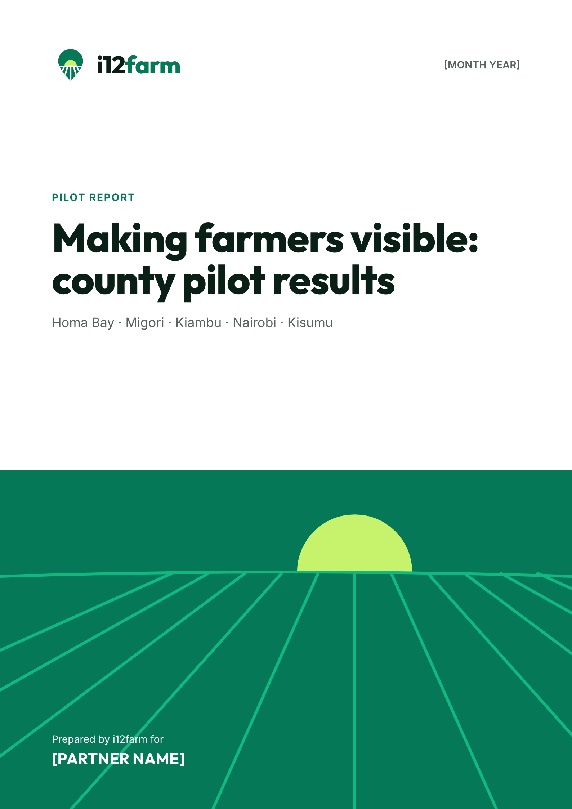
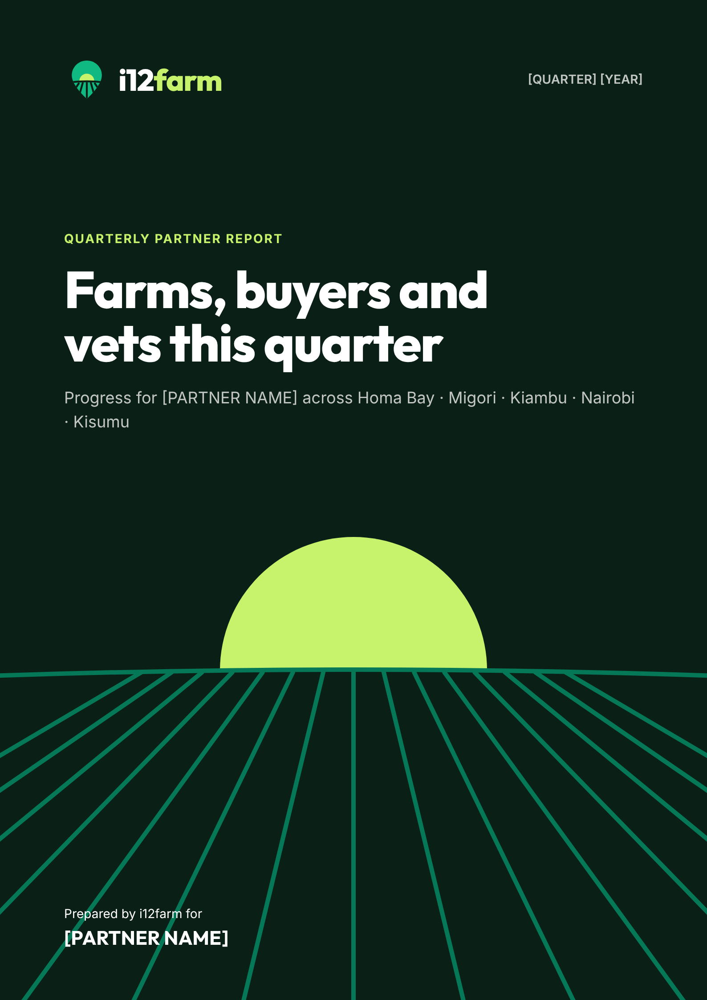
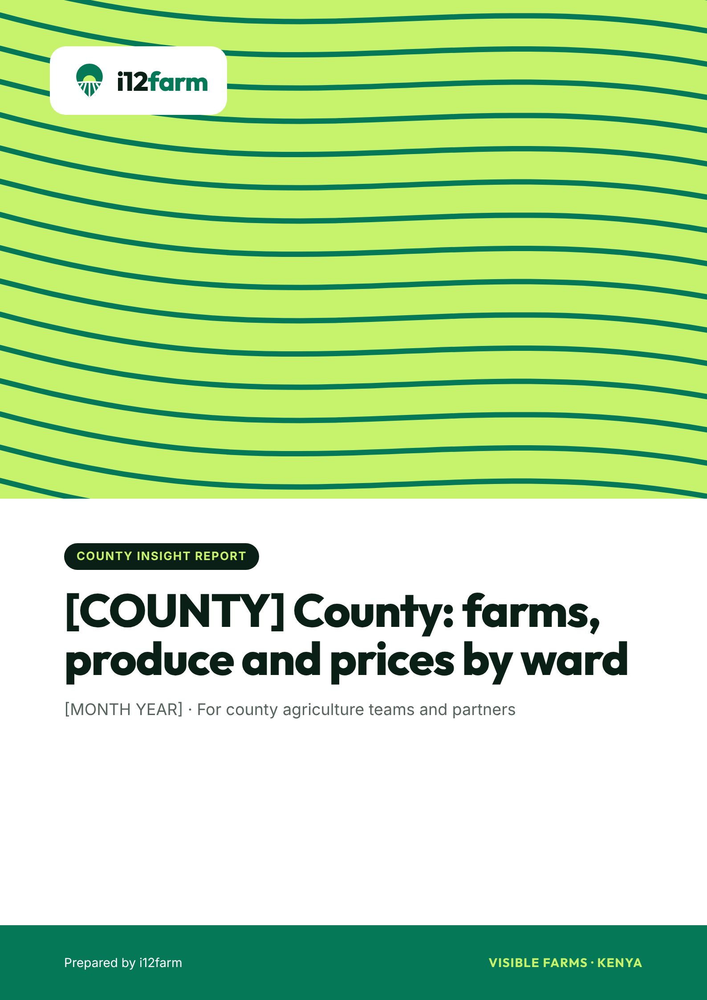
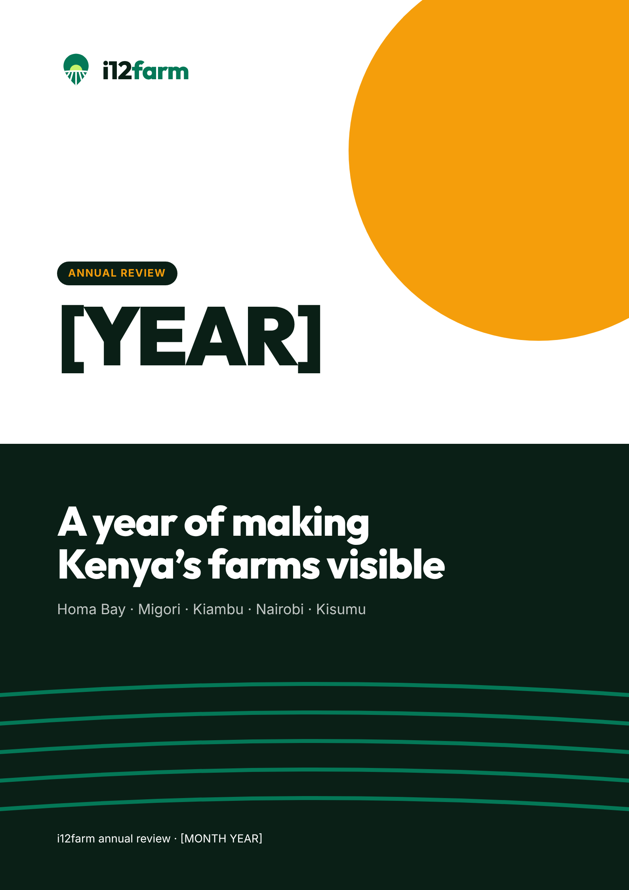
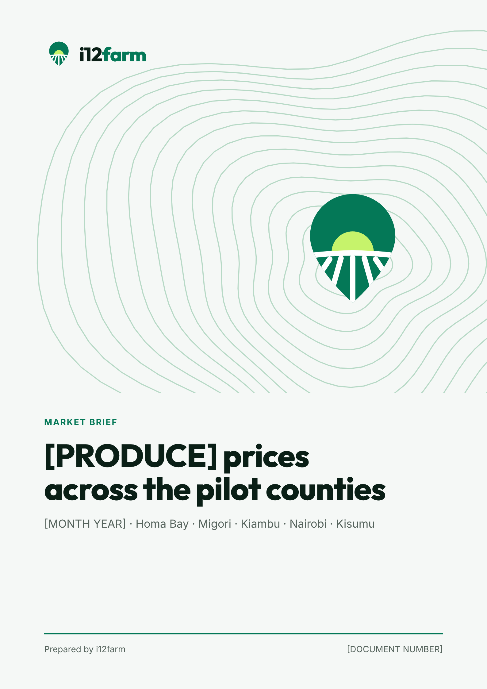
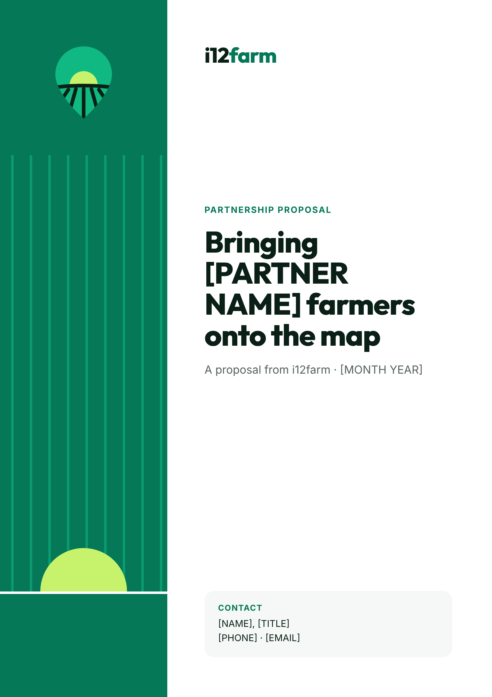

# i12farm Brand Guide

Where and when to use each part of the i12farm brand. Last updated 19 November 2026 (report covers added).

A designed PDF of this guide for partners is in [`i12farm-brand-guide.pdf`](i12farm-brand-guide.pdf).

  

## Summary

i12farm has one master logo, the **Field Pin** with the i12farm wordmark. Use it on everything people outside the team see. Each of the other designs has one narrow job, so the brand never shows two competing logos.

- **Field Pin + wordmark:** the logo. Use it on documents, the app icon, the website, social media, signs and clothing.
- **Seed i:** the tiny version, for spaces under 24 px and plain one-colour icons.
- **Pin Sprout:** no longer a logo. It is an illustration inside the app for "pin your farm".
- **Harvest seal:** a stamp of trust for certificates, verified farms and agreements.
- **Letterhead, report cover, proposal page:** the three document templates. Which one you use depends on what you are sending.

Always write the name **i12farm**: lower case, one word, even at the start of a sentence. Never "i1-2Farm" or "i12farm & Market".

## The logo family

One design leads and the others support it. Never put two of them side by side as equals.

| Design | Role | Use it for | Do not use it for |
| --- | --- | --- | --- |
| **Field Pin + wordmark** | Master logo | Letterhead, report covers, proposals, website header, app icon, Play Store listing, social profile pictures, slides, signs, T-shirts and caps, email signature | Spaces smaller than 24 px, where its field rows blur |
| **Seed i** | Small-size monogram | Browser tab icon (favicon), Android notification icon, photo watermark, very small stamps and stickers | Any place the full logo fits. It is not a second logo |
| **Pin Sprout** | In-app illustration | "Pin your farm" button, onboarding screens, the empty screen before a farmer adds a farm, "New farm" badge | Documents, signs or the app icon. Retire it as the app icon once the Field Pin icon ships |
| **Harvest seal** | Emblem of trust | Training and agent certificates, "Verified farm" stickers and gate signs, signed MOUs, the back cover of reports, merchandise | The letterhead header, or next to the master logo at the same size |

Seed i is needed because Android notification icons must be a plain white shape, and the Field Pin's rows disappear at that size. Pin Sprout suits the app's "pin your farm" action because it is a pin with something growing.

## Logo versions, sizes and backgrounds

Pick the version by the background it sits on, then check the size.

| Version | Background | Where | File |
| --- | --- | --- | --- |
| Full colour lockup | White or Mint Mist | Letterhead, reports, proposals, light web pages and slides, email signature | `logo/field-pin/i12farm-logo-full-colour` |
| Reversed lockup | Forest Ink or Emerald | Dark slides, social posts, dark web sections, dark T-shirts, vehicle and gate signs | `logo/field-pin/i12farm-logo-reversed` |
| App icon | Any | App icon, Play Store, WhatsApp Business and social profile pictures, favicon at 32 px and up | `logo/field-pin/i12farm-app-icon` (+ `-maskable` for Android) |
| Mark only | White, Mint Mist or dark | Where the name already appears nearby: page footers, map markers, app headers | `logo/field-pin/i12farm-mark-*` |
| One colour | Any plain background | Rubber stamps, embroidery, photocopies, newspaper ads, engraving | `logo/field-pin/i12farm-logo-mono-ink`, `-mono-white` |

Every file comes as SVG (for print and the web, any size) and PNG (for Word, slides and WhatsApp).

- **Minimum size:** the lockup at least 30 mm wide in print or 120 px on screen. The mark alone at least 8 mm or 24 px. Below that, use Seed i.
- **Clear space:** keep empty space around the logo equal to half the pin's height on every side. No text, edges or photos inside it.
- **On photos:** place the logo only on a calm, even part of the photo, or on a solid Forest Ink or white panel.

## Colours

Most of any page is white or Mint Mist with Forest Ink text. Emerald and Lime are the accents that make it i12farm. Aim for roughly 60% white or Mint Mist, 25% Forest Ink, 10% Emerald and 5% Lime.

| Colour | HEX | RGB | CMYK | Use it for | Never |
| --- | --- | --- | --- | --- | --- |
| Emerald | #047857 | 4 120 87 | 97 0 27 53 | Logo, headings, rules, buttons, links, the report cover's field block | Long blocks of body text |
| Forest Ink | #0A1F16 | 10 31 22 | 68 0 29 88 | All body text, table header rows, dark panels and slides | — |
| Lime | #C6F36B | 198 243 107 | 19 0 56 5 | Short highlights on Ink or Emerald: labels, badges, the sun in the logo | Text on white (1.3:1, unreadable) |
| Mint Mist | #F5F8F6 | 245 248 246 | 1 0 1 3 | Page tint, callout boxes, table stripes, letterhead footer band | Text colour |
| Sprout | #10B981 | 16 185 129 | 91 0 30 27 | Logo and icons on dark backgrounds, graphics | Small text on white (2.5:1) |
| Harvest Amber | #F59E0B | 245 158 11 | 0 36 96 4 | Prices, warnings, "limited stock", second chart series | Text on white (2.1:1). Put Ink text on Amber instead |
| Soil | #56645D | 86 100 93 | 14 0 7 61 | Secondary text: captions, addresses, footers | Headings |
| Line | #E1E9E4 | 225 233 228 | 3 0 2 9 | Borders, hairlines, dividers | Text |

- **Text pairs that pass:** Forest Ink on white (17.2:1), Emerald on white (5.5:1), white on Emerald (5.5:1), Lime on Forest Ink (13.5:1).
- **Charts:** use the series in this order: Emerald, Lake #4A8FC9, Harvest Amber, Mist grey #9AA8A1. A chart with two series uses Emerald and Amber.
- **Print:** use HEX in Word, Google Docs and Canva. For a professional printer, give the CMYK values and ask for a printed proof before a large run. Office printers shift colours, so print one test page first.

The same values are in [`tokens/colors.json`](tokens/colors.json) and [`tokens/colors.css`](tokens/colors.css), and they match the app's tokens in `src/app/globals.css`.

## Type

Use Outfit for headings and Inter for everything else. Both are free on Google Fonts and already in the app. Install them on every computer that makes documents. If they are missing, use Arial.

| Text | Font | Size in documents |
| --- | --- | --- |
| Cover title | Outfit ExtraBold | 36–42 pt |
| Section heading | Outfit Bold | 20–24 pt |
| Sub-heading | Outfit Bold | 13–14 pt |
| Body text | Inter Regular, line spacing 1.4 | 11–12 pt |
| Captions, footers, addresses | Inter Regular in Soil | 9 pt, never smaller |
| Labels above headings | Inter Bold in Emerald, all caps, wide spacing | 9–10 pt |

Send documents to partners as PDF. In an editable Word file, the fonts may be missing on their computer and the layout will shift.

## Document templates

Choose the template by what you are sending: a letter speaks to one person, a report shows results, and a proposal asks for something.

| Template | Use it for | Do not use it for | How it is built |
| --- | --- | --- | --- |
| **Letterhead** | Formal letters of one or two pages: county governments, ministries, NGOs, banks and Pesi (Switchlink), introduction letters for field agents, invitations, confirmations | Reports, proposals, internal notes | Full colour lockup top left, contact details top right, Lime-and-Emerald rule under the header, Mint Mist footer band with registration details. From page 2: logo and rule only |
| **Report cover** | The front page of anything with results over a period: pilot reports, quarterly partner reports, county insight reports, the annual review | Letters, or documents shorter than three pages | White top half with the lockup, label, big title and counties. Emerald field graphic with the rising sun on the bottom half, with the partner's name on it |
| **Proposal page** | The inside pages of proposals, concept notes, grant applications and reports | A front page on its own | Small lockup and document name as a running header, Emerald section label, Forest Ink table headers, Mint Mist callouts, page number in Emerald |

- **Proposals** and concept notes have their own Emerald cover. See [Report covers](#report-covers).
- **Invoices and receipts** use the letterhead until a dedicated template exists. Keep amounts in Forest Ink, never Amber or Lime.
- **Internal documents** such as meeting notes and plans skip the templates. Use plain Inter text with the mark-only logo in the corner.

Previews of all three templates are in [`templates/`](templates/).

## Report covers

Each type of report has its own cover and colour, so readers can tell documents apart at a glance. All six use the Field Pin logo, the same fonts and the same order: label, title, counties or partner, then date.

| Cover | Colour | Use it for | Printing | Files |
| --- | --- | --- | --- | --- |
| Field | Emerald | Pilot reports and pilot results | Office or professional printer | `templates/report-covers/field` |
| Sunrise | Forest Ink | Quarterly partner reports | Professional printer or PDF. The dark cover uses a lot of ink | `templates/report-covers/sunrise` |
| Crop rows | Lime | County insight reports for county agriculture teams | Office or professional printer | `templates/report-covers/crop-rows` |
| Harvest sun | Harvest Amber | The annual review | Professional printer or PDF | `templates/report-covers/harvest-sun` |
| Map contours | Mint Mist | Market price briefs and research briefs | Office printer | `templates/report-covers/map-contours` |
| Side panel | Emerald | Proposals, concept notes and grant applications | Office or professional printer | `templates/report-covers/side-panel-proposal` |

  
  
  
  
  
  

- Use one cover per report type. A quarterly report never borrows the annual review cover.
- Change only the words in square brackets. Keep the graphics, colours and positions.
- Inside pages always use the proposal page template, whatever the cover.
- Dark covers print poorly on office printers. Send them as a PDF or use a professional printer.

## Quick reference

| Touchpoint | Logo | Colours | Template |
| --- | --- | --- | --- |
| Letter to a county, NGO or bank | Full colour lockup | White page, Emerald rule, Mint Mist footer | Letterhead |
| Pilot or partner report | Full colour lockup on the cover, mark only inside | The cover's colour, white pages | Cover for that report type + proposal pages |
| Proposal, concept note, grant application | Full colour lockup | White, Emerald, Mint Mist callouts | Proposal cover + proposal pages |
| Invoice or receipt | Full colour lockup | Forest Ink on white | Letterhead |
| Training or agent certificate | Harvest seal + full colour lockup | Forest Ink, Emerald, Lime | — |
| "Verified farm" sticker or gate sign | Harvest seal | Forest Ink, Emerald, Lime | — |
| App icon and Play Store | App icon | Forest Ink square | — |
| Browser tab | Seed i | Forest Ink square | — |
| Android notification | Seed i, plain white shape | White | — |
| "Pin your farm" button, onboarding | Pin Sprout illustration | App colours | — |
| WhatsApp Business and social profile picture | App icon | Forest Ink square | — |
| Social media posts | Reversed lockup | Forest Ink or Emerald, Lime highlights | — |
| Slides | Reversed on the title slide, full colour on content slides | Dark title, white content | — |
| Email signature | Full colour lockup, 120 px wide | Forest Ink text, Emerald links | — |
| Field agent T-shirt or cap | Reversed lockup or one colour | Forest Ink or Emerald fabric | — |
| Rubber stamp, photocopies | One colour | Forest Ink | — |
| Photo watermark | Seed i, one colour white | — | — |

## Things to avoid

- Recolouring the logo outside the palette, or swapping the colours of its parts
- Stretching, squashing, rotating, outlining or adding shadows to the logo
- Retyping the wordmark in another font. Always use the logo files
- Using Pin Sprout or Seed i as the main logo, or showing two marks side by side as equals
- Placing the logo on a busy part of a photo without a solid panel
- Lime, Amber or Sprout as text on white
- Writing the name as "I12Farm", "i1-2Farm" or "i12farm & Market"
- Pages packed with Emerald. It is an accent, so keep most of the page white or Mint Mist
